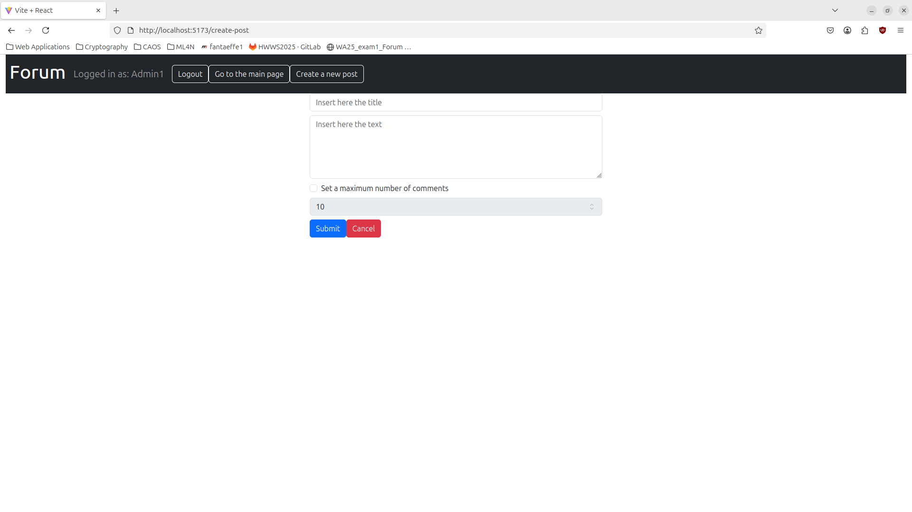
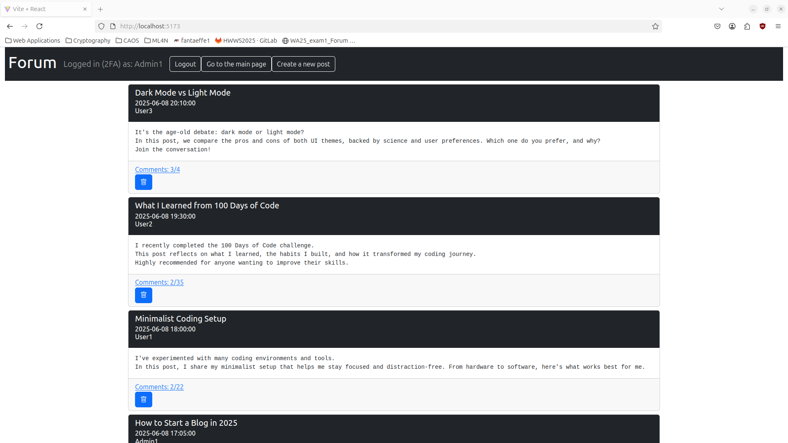

## Discussion Forum Web Application

This project is a full-stack discussion-forum built with a React client and an Express/SQLite server.

The main user interface is implemented with React, React Router, and React-Bootstrap. The backend exposes REST APIs for authentication, posts, comments, and interesting-comment flags. 
The relevant implementation is documented in this file (README.md), with the frontend in client/ and the backend in server/.

The application supports:

* User login with email and password.
* Optional two-factor authentication using TOTP for administrator accounts.
* Public or anonymous comments,(anonymous comments are displayed as written by “Anonymous”).
* Viewing, adding, editing, and deleting comments.
* Marking comments as interesting and viewing how many users are interested in them.

## React Client Application Routes

- Route `/`: homepage list of posts
- Route `/login`: login form (including TOTP form)
- Route `/post/:id`: contains post with all of the informations and comments
- Route `/create-post`: form for creating a new post


## API Server
### Authentication
- POST `/api/sessions`
  - **request**: json object with email and password
    ```
      {
      "password": "pwd",
      "username": "u1@p.it"
      } 
    ```
  - **response**: json object with user informations to identify user and wheter it's admin or not
    ```
    {
      "id": 1,
      "username": "u1@p.it",
      "name": "Admin1",
      "canDoTotp": true,
      "isTotp": false
    }
    ```
- POST `/api/login-totp`
  - **request**: json object with otp
    ```
    {
      "code": "774567"
    }
    ```
  - **response**: json object with user informations to identify user and wheter it's admin or not
    ```
    {
      "id": 1,
      "username": "u1@p.it",
      "name": "Admin1",
      "canDoTotp": true,
      "isTotp": false
    }
    ```
- GET `/api/sessions/current`
Used to get user informations the request includes credentials (cookie)
  - **response**: 
    ```
    {
      "id": 1,
      "username": "u1@p.it",
      "name": "Admin1",
      "canDoTotp": true,
      "isTotp": false
    }
    ```
- DELETE `/api/sessions/current`
performs log out

### Post and comments
- GET `/api/posts`
  - **Response body**: JSON object with the list of posts, or description of the error(s):
    ```
    [
      {
        "id":11,
        "userID":1,
        "title":"new post",
        "text":"this is the text",
        "maxComments":10,
        "timestamp":"2025-06-22 16:21:49",
        "authorName":"Admin1",
        "numComments":2
      },
      ...
    ]
    ```
- GET `/api/comments/:postID`
empty requests, postID is taken from url returns the list of comments for a post
  - **response**: 
    ```
    [
      {
      "commentID":24,
      "commentText":"Congrats! I’m on day 42 right now.",
      "timestamp":"2025-06-08 19:40:00",
      "authorName":"Anonymous",
      "numInteresting":0
      },
      ...
    ]
    ```
- GET `/api/post/:postID`
  empty request, postID is taken from url, returns information about a post
  - **response**: 
    ```
    {
    "id":9,
    "userID":4,
    "title":"What I Learned from 100 Days of Code",
    "text":"I recently ...",
    "maxComments":35,
    "timestamp":"2025-06-08 19:30:00",
    "authorName":"User2",
    "numComments":2
    }
    ```

- POST `/api/addComment/:postID`
  - **request**: json object with the text of the comment
    ```
    {"comment":"new comment"}
    ```
  - **response**: return the entire comment
    ```
    {
      "commentID":26,
      "commentText":"new comment",
      "timestamp":"2025-06-22 16:20:03",
      "authorName":"Admin1"
    }
    ```
- POST `/api/addPost`
  - **request**: json object with info to create the post, maxComment is set to -1 in case
    ```
    {
      "title":"new post",
      "text":"this is the text",
      "maxComments":10
    }
    ```
  - **response**: 
    ```
    {
      "id":11,
      "userID":1,
      "title":"new post",
      "text":"this is the text",
      "maxComments":10,
      "timestamp":"2025-06-22 16:21:49",
      "authorName":"Admin1",
      "numComments":0
    }
    ```
- PUT `/api/editComment/:commentID`
  - **request**: json object with the new text of the comment
    ```
    {"comment":"edited comment"}
    ```
  - **response**: return the entire comment
    ```
    {
      "commentID":26,
      "commentText":"new comment",
      "timestamp":"2025-06-22 16:20:03",
      "authorName":"Admin1"
    }
    ```
- DELETE `/api/deleteComment/:commentID`
deletes a comment
- DELETE `/api/deletePost/:postID`
deletes a post and all related comments
- GET `/api/interestingComments/:postID`
  empty request
  - **response**: json object containing the list of comments IDs of a post flagged by the user as interesting
    ```
    [
      {"commentID":28}
    ]
    ```
- POST `/api/addInterestingComment/:commentID`
  emtpy request, returns true if successful
- DELETE `/api/deleteInterestingComment/:commentID`
sets a comment as "not interesting"
## Database Tables

- Table `users` - contains id, email, name, hash, salt, secret for 2FA (only for admins)
- Table `posts` - contains id, userID, title, text, maxComments, timestamp
- Table `comments` - contains id, postID, authorID, text, timestamp
- Table `interestingComments` - contains  userID, commentID

All of the IDs are integers with autoincrement set as primary keys.
Foreign keys are used to allow cascade on delete.
The DB also contains rules for comments and post uniqueness.

## Main React Components

- `PostsListLayout` (in `Post.js`): displays a list of posts, allows to delete posts.
- `CommentsLayout` (in `Post.js`): displays a single post with all of the comments, allows creating, deleting and modifying comments.
- `CreatePostForm` (in `Post.js`): form to create a new post.
## Screenshot




## Users Credentials

The application does not currently support user registration.
You can use the following preconfigured accounts to test the application.

|username|email|password|2FA secret|
|---|---|---|---|
|admin1|u1@p.it|pwd|LXBSMDTMSP2I5XFXIYRGFVWSFI|
|admin2|u2@p.it|pwd|LXBSMDTMSP2I5XFXIYRGFVWSFI|
|user3|u3@p.it|pwd||
|user4|u4@p.it|pwd||
|user5|u5@p.it|pwd||

These credentials are publicly available for testing purposes only.